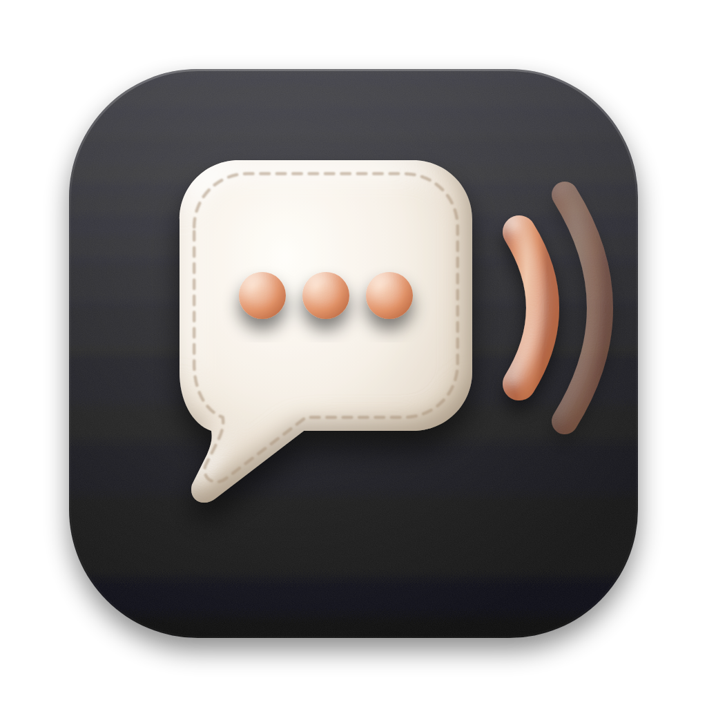

# hush



A menu bar app that lowers your music when someone starts talking, then brings it back when the room goes quiet. Everything runs on this Mac.

## How it decides

1. **Is music playing?** A Core Audio process tap (macOS 14.4+) listens to everything the Mac outputs. The tap sits before the volume control, so it still hears the music after hush has turned it down.
2. **Is a person talking?** The mic is read directly through Core Audio and goes through the same classifier. It uses the Mac's own mic by default, so AirPods stay in high-quality stereo.
3. **The model** is Apple's built-in sound classifier (`SoundAnalysis`, 303 labels, about 100× faster than real time on Apple silicon, no download). It gives a confidence score for speech, music and singing in 1 s windows, every 0.25 s.
4. **The decision layer** (`DecisionEngine.swift`) is pure and unit-tested:
   - It only ducks while music is playing and the volume is at least 10%.
   - Voice score = mic speech − 0.5 × vocals in the music. Song lyrics coming out of the speakers into the mic shouldn't trigger a duck.
   - The trigger threshold comes from the sensitivity setting. It also adapts to a baseline it learns for the room while nobody is talking.
   - Speech has to last 0.3 s, so a cough or a single word is ignored.
   - Ducking ramps down in 0.35 s to 30% of your volume (about −10 dB). The music comes back over 1.5 s after 2.5 s of quiet, or right away when the music stops.
   - If you move the volume while ducked, your setting stays. If hush quits or crashes while ducked, your volume is restored on the next launch.

## Build

```sh
./build.sh            # builds and installs /Applications/Hush.app
.build/release/Hush --selftest --simulate music.wav mic.wav --snapshot shots/
```

Permissions on first launch: Microphone, and System Audio Recording (System Settings › Privacy & Security › Screen & System Audio Recording › System Audio Recording Only).
The app is signed ad hoc, so macOS asks again after each rebuild.

## Debugging

Hush writes one status line a second to `~/Library/Logs/Hush.log`. Each line has what the classifier heard from the output and from the mic, the smoothed scores, the threshold, the volume, and how much audio each source has delivered. Phase changes get their own line. Use `tail -f` on it while tuning.

## Requirements

macOS 14.4 or later (Core Audio process taps), Apple silicon recommended, Xcode command line tools.
`build.sh` signs with your Apple Development certificate if you have one, otherwise ad hoc.

## License

MIT
